<div align="center">

<picture>
  <source media="(prefers-reduced-motion: reduce)" srcset="./terminal-static.svg">
  
</picture>

<br>

`software engineering` · `systems` · `data` · `applied AI`

</div>

---

## `projects --selected`

<table>
<tr>
<td width="50%" valign="top">

### [`golang-text-editor`](https://github.com/timtiminspace/golang-text-editor)

**A lightweight terminal text editor written in Go.**

An exploration of terminal interfaces, text buffers, cursor movement, scrolling, search and file I/O.

`Go` `termbox-go` `systems`

</td>
<td width="50%" valign="top">

### [`smart-campus-energy-anomaly-dashboard`](https://github.com/timtiminspace/smart-campus-energy-anomaly-dashboard)

**Smart-campus energy monitoring and anomaly detection.**

A dashboard for inspecting energy use and surfacing unusual consumption patterns.

`TypeScript` `React` `FastAPI` `data`

</td>
</tr>

<tr>
<td width="50%" valign="top">

### [`trading-bot`](https://github.com/timtiminspace/trading-bot)

**A quantitative trading research platform.**

Research-oriented tooling for exploring strategies and working with market data.

`Python` `quant research` `data analysis`

</td>
<td width="50%" valign="top">

### `currently`

**Computer Science at the University of Surrey.**

Interested in building practical software across systems, full-stack engineering, security and applied AI.

`learning` `building` `iterating`

</td>
</tr>
</table>

---

## `stack --compact`

<div align="center">


</div>

```text
languages  Go · Python · Java · C++ · JavaScript · TypeScript
backend    Go · Django · FastAPI · REST
frontend   React · HTML · CSS
data       SQLite · pandas · NumPy
tools      Linux · Git · Docker
```

---

<div align="center">

<a href="https://github.com/timtiminspace?tab=repositories">
  
</a>

<br><br>

<sub>minimal by design · animation generated from source in this repository</sub>

</div>
